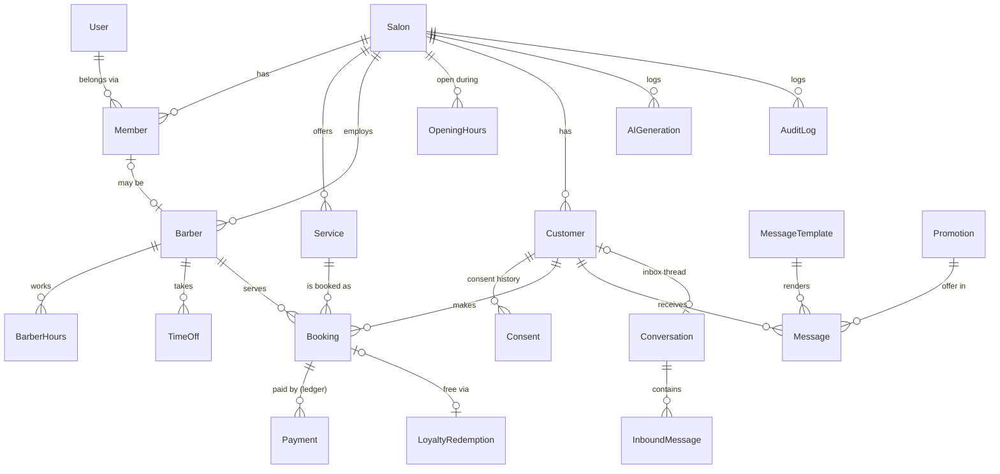

# Data Model

The schema itself is [prisma/schema.prisma](../prisma/schema.prisma). Conventions are in [ADR-0008](adr/0008-data-conventions.md), and tenancy is in [ADR-0002](adr/0002-multi-tenancy.md).

## Key design points

| Concern | How the schema handles it |
|---|---|
| Tenant isolation | `salonId` on every tenant-owned table, and every unique key starts with `salonId` |
| Duplicate customers | `@@unique([salonId, phoneE164])` |
| Double booking | Exclusion constraint in [prisma/sql/booking_no_overlap.sql](../prisma/sql/booking_no_overlap.sql) (walk-ins exempt, BR-A6) |
| Payment status | Not stored; calculated from immutable `Payment` rows (BR-P1, BR-P2) |
| Loyalty stamps | Not stored; calculated from completed bookings minus redemptions (BR-L4) |
| Consent | Append-only `Consent` rows that store the wording shown; the latest row per purpose is the current consent |
| Message queue and log | One `Message` table with `idempotencyKey` (ADR-0004, BR-R8). `DRAFT` = waiting for approval |
| 24-hour window | `Conversation.lastInboundAt` |
| Retention experiment | `Customer.holdout` marks the control group: customers who get no win-back or offer messages, so their return rate shows what the messages add |
| AI traceability | `AIGeneration` stores prompt version, model, guardrail results, cost and final approved text |
| Data rights | `Customer.anonymisedAt`. Personal fields are cleared; financial rows remain |

## Derived values (calculated by code, kept up to date on booking completion)

`Customer.visitCount`, `lastVisitAt` and `usualGapDays` are cached to keep dashboard and segment queries fast. They are recalculated when a booking is completed or reverted (BR-B5), and a nightly job checks they haven't drifted.
